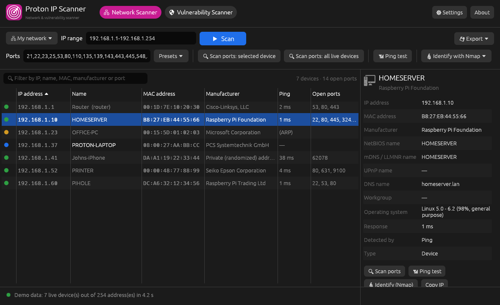
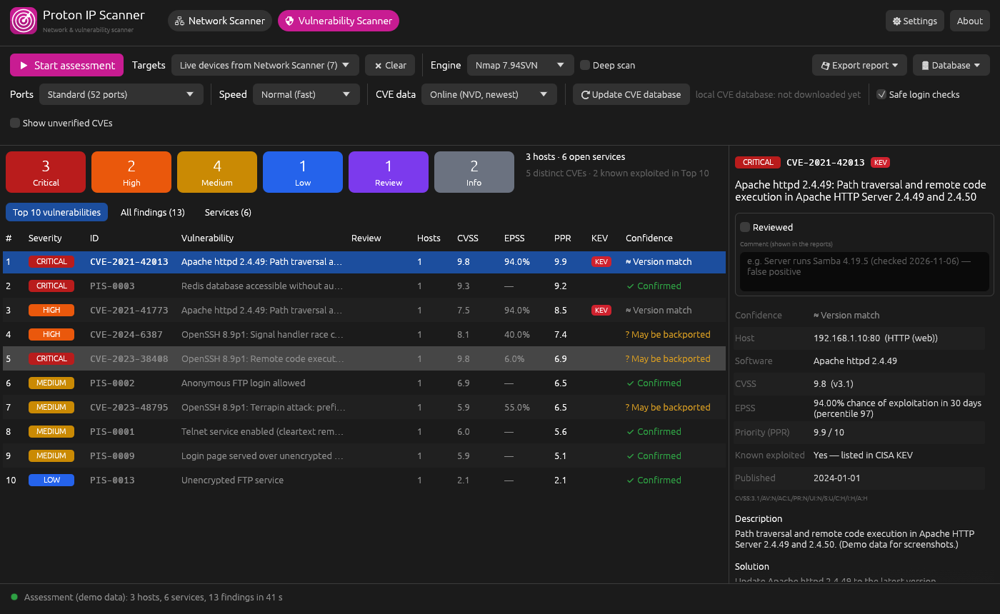
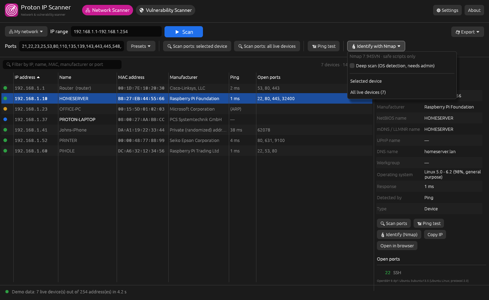

<div align="center">


# Proton IP Scanner

**A fast, friendly network and vulnerability scanner for Linux and Windows.**

Find every device on your network — computers, phones, printers, TVs, smart plugs — with their
IP address, MAC address, manufacturer, name and open ports. Then check their services for known
vulnerabilities, ranked with CVSS v4, EPSS and a VPR-style priority, and export an Excel or PDF report.
Part of the [Proton OS](https://www.protonos.org) family.




</div>

## Features

### Network Scanner tab
- One click scans your own network (detected automatically) and then **checks the 28 most common
  ports on every device it finds**.
- For each live device: **IP**, **MAC address**, **manufacturer**, **name**, **ping time**, open ports,
  and whether it is your router or this computer.
- **Names from six sources**, asked in parallel: the **router's DNS** (DHCP names, asked directly),
  NetBIOS (Windows/Samba), **mDNS** (iPhones, Macs, printers, Linux/Avahi), **LLMNR** (Windows),
  **UPnP** friendly names (TVs, media players, NAS, printers, routers) and the system resolver — plus a
  multicast mDNS/UPnP sweep at the start of each scan for devices that only answer multicast.
- **Manufacturers from all three IEEE registries** (54 000 prefixes, incl. the small MA-M/MA-S blocks
  used by IoT and camera makers). Phones with private Wi-Fi addresses are labelled as such.
- Finds devices that block ping (Windows PCs with the firewall on) through ARP — amber dot.
- **Ping test** for the selected device: live latency chart, packet loss, min/avg/max, jitter and a
  plain-language verdict ("Excellent", "Fair — weak Wi-Fi?"…).
- Port scan the selected device or all devices; presets or your own list (`22,80,8000-8100`).
- **🔬 Identify with Nmap** (optional, when [Nmap](https://nmap.org) is installed): exact service versions,
  the **operating system** (deep scan), and device details from Nmap's safe identification scripts
  (certificate names, page titles, SMB/OS information) for the selected device or all devices.
- Click anywhere on a row to select it; right-click to copy the IP, MAC, name, manufacturer or all details
  (no text-selection cursor getting in the way). CSV / HTML export, light and dark theme.

### Vulnerability Scanner tab


- Assess the **selected device**, all **live devices from the Network Scanner tab**, or any IP range.
- **Three port lists**: *Standard* (52 ports, fast), *Comprehensive* (1,298 ports: all of 1-1024 plus
  ~270 registered admin/database/IoT/industrial ports) and *Full scan* (all 65,535) — or your own.
- **Service detection**: SSH, web servers (HTTP/HTTPS headers), FTP, SMTP, MySQL/MariaDB, Redis,
  memcached, VNC, MQTT, Docker API, Elasticsearch — also on unusual ports.
- **Known vulnerabilities (CVEs)** for each detected software version from **NIST NVD** — online, or from
  an **offline database** for computers without internet (see below) — with
  - **CVSS v4.0** severity (v3.1/v3.0/v2.0 when NVD has no v4.0 score yet, clearly labelled),
  - **EPSS** — probability of exploitation in the next 30 days (FIRST),
  - **KEV** — known exploited, from CISA's catalog,
  - **PPR** — *Proton Priority Rating*, a VPR-style 0–10 score (see below).
- **19 safe configuration checks** (CVSS v4.0-scored): Redis / Elasticsearch / memcached / Docker API
  without authentication, VNC without password, anonymous FTP, anonymous MQTT, Telnet, login pages over
  plain HTTP, exposed RDP / SMB / databases, and more.
- **Optional Nmap engine**: Nmap's version detection plus its **safe NSE scripts only** (Heartbleed, POODLE,
  MS17-010, SMB signing, SSLv2, expired certificates, risky HTTP methods, open X11 …), merged with Proton's own
  checks. Vulnerabilities a script confirms are scored with NVD/EPSS like every other CVE.
  **Deep scan** (SYN scan + OS detection) asks for admin rights **for that one run only** — see
  [Nmap](#nmap-optional).
- **Confidence on every finding** (Confirmed · Version match · May be backported · Unverified), and a
  **Needs manual check** item (severity *Review*) when only an approximate version is visible — e.g. Samba "4" —
  listing the CVEs that could apply and how to check the installed version, instead of false positives.
- **Top 10 vulnerabilities** by priority, all findings (click a severity to filter), services list, and a
  details panel with description, solution, evidence and references.
- **Slow probing** so scans are not blocked: *Normal*, *Polite* (fewer probes, random pauses) or
  *Slow / stealthy* (1–2 probes at a time, 1–3 s random pauses, shuffled order).
- **Reports**: Excel workbook (Summary, Top 10, Findings, Vulnerabilities, Services, Method) and a
  branded **PDF** (summary, Top 10, every finding with affected hosts, services, methodology).

### Safe and light
- **Never needs root or administrator rights.** Nothing runs in the background. The only external program
  is Nmap, if you install it and choose it; admin rights are requested only when you tick *Deep scan*,
  only for that one Nmap run.
- Online lookups send **only product names/versions and CVE numbers** — never IP addresses or results.
  They can be switched off.
- Uses **no CPU when idle**; a full vulnerability assessment from the command line uses ~9 MB of memory.
- See [docs/SECURITY-REVIEW.md](docs/SECURITY-REVIEW.md).

## Install

Downloads: [latest release](https://github.com/ProtonOS-Linux/proton-network-scanner/releases/latest).

### Proton OS

Already set up: open **Discover**, search for *Proton IP Scanner*, Install — or `sudo apt install proton-ip-scanner`.
Updates arrive with the other system updates.

### Debian, Ubuntu, Linux Mint (Debian 11+ / Ubuntu 20.04+)

Add the Proton OS repository once, so updates come with `apt upgrade` / Discover:

```bash
wget https://protonos-linux.github.io/apt/proton-os-archive-keyring.deb
sudo apt install ./proton-os-archive-keyring.deb
sudo apt update
sudo apt install proton-ip-scanner
```

Or install just the downloaded package: `sudo apt install ./proton-ip-scanner_*_amd64.deb` (no automatic
updates). It adds *Proton IP Scanner* to the application menu. Other Linux: extract the `linux-x86_64.tar.gz`
and run `proton-ip-scanner`.

### Windows 10 / 11 (64-bit)

Run **`ProtonIPScanner-<version>-Setup.exe`**. It installs to *Program Files*, adds Start menu and desktop
shortcuts, an entry in *Settings → Apps* (to uninstall), and a firewall rule that lets the scanner receive
replies from devices on **private** networks (not public ones). The app itself never runs as administrator.
There is also a portable `…-windows-portable.exe` that needs no installation.

**"Windows protected your PC" / unknown publisher warning:** Windows SmartScreen shows this for programs that are
not signed with a paid code-signing certificate and have not yet been downloaded by many people. It is not a
virus detection. Click **More info → Run anyway**. You can check the download against `SHA256SUMS.txt` in the
release (`Get-FileHash .\ProtonIPScanner-*-Setup.exe` in PowerShell). The warning goes away once releases are
signed — the build is ready for that (see `.github/workflows/ci.yml`, secrets `WINDOWS_CERT_PFX` /
`WINDOWS_CERT_PASSWORD`; free signing for open-source projects is available from SignPath Foundation, or Azure
Trusted Signing for a small monthly fee). If Microsoft Defender itself flags the file (network scanners are
sometimes classified as "hacking tools"), report the false positive at
<https://www.microsoft.com/wdsi/filesubmission>.

## Using it

**Find devices**
1. Press **▶ Scan**. The range is filled in for your network (pick another with **My network**, or type
   `192.168.1.1-254`, `10.0.0.0/24`, or `192.168.1.5, 192.168.1.9`).
2. Devices appear as they answer; then their common ports are checked automatically.
3. Click a device for details. **📶 Ping test** measures latency and packet loss.

**Check for vulnerabilities**
1. Open the **Vulnerability Scanner** tab. Targets default to the devices you just found.
2. Pick ports (the 52-port *Vulnerability set* is a good start) and a speed.
3. Press **▶ Start assessment**. Findings appear as they are found; CVE lookups run at the end.
4. **Export report** → Excel or PDF (saved in your Documents folder).

Optional: a free [NVD API key](https://nvd.nist.gov/developers/request-an-api-key) (Settings, or the
`NVD_API_KEY` environment variable) makes CVE lookups about 10× faster.

**Every assessment starts fresh**: results, notes and filters from earlier scans are cleared, and no CVE
lookups are cached between scans (version 1.1.0 kept a 24-hour cache; it is deleted on start). If the
same CVE shows up on two machines, they announce the same software version — e.g. the same OpenSSH build.

### CVE data: online, offline database, or off

| CVE data | What happens | Internet needed |
|---|---|---|
| **Online** (default) | During each scan, NVD is asked about every detected product version, and FIRST for EPSS. If NVD can't be reached, the offline database is used automatically. | yes (falls back to offline) |
| **Offline database** | Versions are matched locally against a downloaded database of every CVE for every product the scanner recognises (version ranges, CVSS, EPSS, KEV). Nothing is sent anywhere. | no |
| **Off** | Configuration checks only. | no |

**Using it on a network without internet:**
1. On any computer with internet: *Vulnerability Scanner → 🗄 Database → Download / update* (about 3 minutes,
   faster with an NVD API key), then *Export to Documents*. You get `proton-vulndb-YYYYMMDD-HHMMSS.json.gz`
   (a few MB).
2. Copy the file to the offline computer (USB stick, file share) into its Documents or Downloads folder.
3. There: *🗄 Database → Import from Documents / Downloads* and pick the file. Choose **CVE data: Offline
   database** (or leave Online — it falls back automatically).
4. Repeat now and then (weekly is a good habit): new CVEs appear every day. The app warns when the database
   is more than 30 days old.

**Keeping it current:** the **⟳ Update CVE database** button (Vulnerability Scanner tab, next to *CVE data*)
refreshes the local database at any time, and by default the app refreshes it **automatically in the background
when it opens** (at most about once a day; skipped quietly when there is no internet). Turn that off in
*Settings → CVE database*.

Command line: `--update-db`, `--export-db`, `--import-db <file>`, and `--cve online|offline|off` for `--vuln`.

Status dots: 🟢 answered ping · 🟠 online but blocks ping (found via ARP) · 🔵 this computer.

### How the scores work

| Score | Meaning |
|---|---|
| **CVSS v4.0** | How severe a vulnerability is, 0–10 (FIRST). Critical ≥ 9, High ≥ 7, Medium ≥ 4, Low > 0. |
| **EPSS** | Probability of exploitation in the wild within 30 days (FIRST), with percentile. |
| **KEV** | Listed in CISA's Known Exploited Vulnerabilities catalog — fix these first. |
| **PPR** | *Proton Priority Rating* 0–10: `0.6 × CVSS + 0.4 × threat`, where threat = 10 if KEV, otherwise `10 × √EPSS` (2.0 if no EPSS yet). Tenable's VPR is proprietary; PPR follows the same idea with public data. The Top 10 is ordered by PPR. |

CVE matches are based on the version a service announces (like other scanners' remote version
checks). Linux distributions back-port fixes without changing version numbers; such findings are
marked so you can confirm them with the installed package version.

### Nmap (optional)

Proton IP Scanner works on its own. If [Nmap](https://nmap.org) is installed it can also use it:



| | Normal (default) | Deep scan (tick the box) |
|---|---|---|
| Port scan | TCP connect (as you) | SYN scan |
| Services | Nmap version detection | same |
| Scripts | **safe** NSE scripts only | same |
| Operating system | from what services report | **Nmap OS detection** |
| Rights | your user, **no admin** | Linux: password prompt (pkexec) **for this one run**; Windows: Npcap driver, no prompt |

* **Install**: Linux `sudo apt install nmap` (the .deb recommends it). Windows: the installer from
  [nmap.org/download](https://nmap.org/download.html) (includes Npcap). Then Settings → **⟳ Look again**,
  or restart the app.
* **Scripts**: Nmap's `default` and `vuln` scripts that Nmap itself classifies as `safe`, minus every
  intrusive, DoS, exploit, brute-force, fuzzing, malware, broadcast and external (internet) category — and
  minus `http-slowloris-check` and `ftp-bounce`. With *Safe login checks* off, the anonymous-login scripts
  are left out too.
* **Deep scan on Linux** only runs an Nmap installed by the package manager (owned by root, in `/usr/bin`
  or another system folder). An Nmap you built or copied into your home folder is used for normal scans only.
* Where to find it: **Network Scanner → 🔬 Identify with Nmap** and **Vulnerability Scanner → Engine**.
* Nmap is not included in Proton IP Scanner (it has its own licence); it is found on your system.

### Command line

```text
proton-ip-scanner --scan auto                              your network + common ports
proton-ip-scanner --scan 192.168.1.0/24 --ports 22,80,443  find devices, then scan these ports
proton-ip-scanner --scan 10.0.0.1-50 --csv > devices.csv   CSV output
proton-ip-scanner --scan auto --vuln --report pdf          vulnerability assessment + PDF report
proton-ip-scanner --scan 10.0.0.5 --vuln --stealth         very slow, hard-to-detect probing
proton-ip-scanner --scan auto --vuln --cve offline         use the offline CVE database only
proton-ip-scanner --scan auto --nmap                       + OS and service versions from Nmap
proton-ip-scanner --scan auto --vuln --nmap --deep         Nmap engine, SYN scan + OS detection (asks for admin)
proton-ip-scanner --update-db                              download/update the offline CVE database
proton-ip-scanner --help
```

Options: `--ports`, `--no-ports`, `--threads N`, `--timeout MS`, `--banners`, `--no-names`, `--slow`,
`--csv`, `--nmap`, `--deep`; with `--vuln`: `--report pdf|xlsx`, `--cve online|offline|off` (`--offline` = offline), `--stealth`,
`--no-logins`; database: `--update-db`, `--export-db`, `--import-db <file>`.

Environment: `PROTON_IP_SCANNER_THEME=light|dark` forces a theme; `PROTON_IP_SCANNER_DEMO=1` (or `vuln`,
`ping`) shows example data for screenshots without scanning.

> Only scan networks you own or have permission to scan.

## How it works

| Step | Linux | Windows |
|---|---|---|
| Is it alive? | Unprivileged ICMP "ping socket" (no root) | `IcmpSendEcho` (same API as `ping.exe`) |
| Fallback | TCP probe of common ports | TCP probe of common ports |
| MAC address | `/proc/net/arp` | `SendARP` |
| Manufacturer | Built-in IEEE MA-L/MA-M/MA-S list | same |
| Names | Router DNS (UDP 53) + NetBIOS (UDP 137) + mDNS (UDP 5353) + LLMNR (UDP 5355) + UPnP/SSDP (UDP 1900 + description XML) + system resolver | same |
| Ports | TCP connect scan | same |
| Services | Banners, HTTP(S) headers, protocol handshakes | same |
| Nmap (optional) | `nmap` started directly (no shell), targets on stdin, XML on stdout; deep scan via `pkexec` | `nmap.exe`, deep scan via Npcap (`--privileged`) |
| CVEs | NVD API 2.0 (CPE match) + FIRST EPSS API over HTTPS, or the offline database (local version-range matching) | same |

### Code layout

```text
src/main.rs              entry point: window or command line
src/config.rs            remembered settings (settings.json)
build.rs                 Windows icon, version info and manifest
packaging/windows/       NSIS installer script and artwork
src/cli.rs               --scan / --vuln command-line mode
src/app/mod.rs           window shell, tabs, Network Scanner tab, settings
src/app/vuln_tab.rs      Vulnerability Scanner tab
src/app/ping_window.rs   ping test window (chart + statistics)
src/app/widgets.rs       shared colours, logo, toolbar sizing, severity tags
src/scanner/mod.rs       job + worker pool, pacing (Normal/Polite/Slow), discovery
src/scanner/range.rs     parsing IP ranges and port lists (with limits)
src/scanner/ping.rs      ICMP ping (Linux / Windows) and TCP probe
src/scanner/pingtest.rs  continuous ping test engine and statistics
src/scanner/mac.rs       ARP table lookup
src/scanner/vendor.rs    manufacturer lookup (data/oui.tsv, longest prefix)
src/scanner/names.rs     router DNS, NetBIOS, mDNS, LLMNR, UPnP, multicast sweep, sanitising
src/scanner/ports.rs     port scan, presets, service names, banners
src/vuln/mod.rs          assessment phases, findings, Top 10
src/vuln/detect.rs       service detection, product → CPE, safe checks
src/vuln/checks.rs       Proton configuration checks (CVSS v4.0 vectors)
src/vuln/nvd.rs          NVD + EPSS client, parsing, CPE version rules
src/vuln/offline.rs      offline CVE database: download, export/import, local matching
src/vuln/score.rs        severity bands, priority rating (PPR)
src/vuln/nse.rs          Nmap results in assessments: CPE mapping, NSE script findings
src/nmap/mod.rs          optional Nmap engine: finding Nmap, safe arguments, running, deep-scan elevation
src/nmap/parse.rs        streaming parser for Nmap's XML output (untrusted input)
src/report/xlsx.rs       Excel report
src/report/pdf.rs        PDF report (self-contained writer)
src/export.rs            CSV / HTML device lists, safe file saving
src/fuzz_tests.rs        robustness tests for all network parsers
tools/make-oui.py        regenerates data/oui.tsv from IEEE data
```

Every module starts with a comment explaining what it does and why; security-relevant code is
marked where it happens.

## Build from source

Needs **Rust 1.95+** (Debian's packaged rustc is older) ([rustup](https://rustup.rs)).

```bash
# Linux build dependencies (Debian/Ubuntu)
sudo apt install build-essential pkg-config libxkbcommon-dev libgl1-mesa-dev
# Release builds use cargo-zigbuild so the binary runs on glibc 2.30+:
#   pip install ziglang && cargo install cargo-zigbuild cargo-deb
#   cargo zigbuild --release --target x86_64-unknown-linux-gnu.2.31
#   cargo deb --target x86_64-unknown-linux-gnu --no-build
# Windows installer (NSIS 3, from Linux or Windows):
#   makensis -DVERSION=1.4.0 -DEXE=<path to .exe> -DOUTDIR=dist packaging/windows/installer.nsi

git clone https://github.com/ProtonOS-Linux/proton-network-scanner.git
cd proton-network-scanner
cargo test
cargo build --release                 # target/release/proton-ip-scanner
cargo install cargo-deb && cargo deb  # target/debian/*.deb
```

Windows: install Rust with rustup, then `cargo build --release` gives `proton-ip-scanner.exe`.
Cross-compiling from Linux: `rustup target add x86_64-pc-windows-gnu`, install `mingw-w64`, then
`cargo build --release --target x86_64-pc-windows-gnu`.

## License

GNU General Public License v3.0 or later — see [LICENSE](LICENSE).
Copyright © 2026 Proton OS contributors · support@protonos.org.
Manufacturer data: IEEE Registration Authority, via the `oui-data` package (BSD licence,
`data/oui-data-LICENSE.txt`). Vulnerability data: NIST NVD, FIRST EPSS, CISA KEV (public).
This product uses the NVD API but is not endorsed or certified by the NVD.
Inspired by Angry IP Scanner, Advanced IP Scanner and Nessus; not affiliated with any of them.
